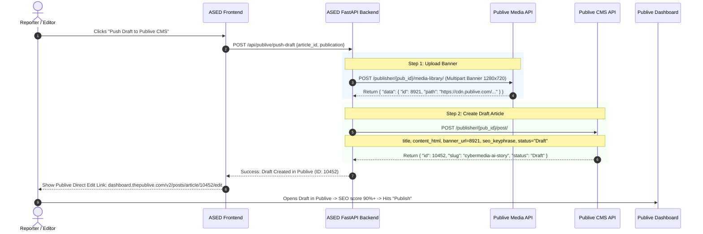

# 🚀 Publive DXP Integration: Technical Assessment & Feasibility Report

**Project:** CyberMedia AI Stack for Edit Desk (ASED) <> Publive DXP Integration  
**Prepared By:** Ritik Shroff (Project Lead / Lead Developer)  
**Stakeholders:** Dhaval Gupta, Sudesh Prasad  
**Date:** October 9, 2026  
**Reference Documentation:** [Publive DXP Official Documentation](https://docs.thepublive.com/dxp) | [API Developer Hub](https://dashboard.thepublive.com/v2/configurations/api-developer-hub)

---

## Executive Summary & Strategic Verdict

### 1. Key Takeaway & Feasibility Verdict
* **Feasibility:** **100% Viable & Ready for Immediate Implementation.**
* **Open API Confirmation:** Dhaval is **100% correct**. Publive provides a comprehensive, documented, server-side Headless CMS REST API suite.
* **No Extra Vendor Development Cost Required:** All 5 core capabilities requested by Sudesh Sir for Phase 1 (Auth, Taxonomy, Media Upload, Article Creation/Drafting, and SEO metadata) and Phase 2 (Publish Webhooks) **already exist natively in production** on Publive DXP. Publive does not need to write new APIs.
* **Resolution to Editorial Pain Points:**
  * Eliminates manual 15–20 minute copy-pasting per story.
  * Solves the `0% Oops! Enhance your SEO score` problem by automatically pushing SEO Focus Keyphrase, Meta Title, and Meta Description during draft creation.
  * Uploads the 1280x720 banner directly into Publive’s Media Library and links it to the story automatically.

---

## 2. Publive DXP Architecture Overview

Publive DXP splits its architecture into two distinct services:

```
+-------------------------------------------------------------------------------+
|                                PUBLIVE DXP                                    |
|                                                                               |
|   +------------------------------------+   +-------------------------------+  |
|   |  Content Management Service (CMS)  |   | Content Delivery Service (CDS)|  |
|   |   https://cms.thepublive.com       |   |   https://cds.thepublive.com  |  |
|   |   • Full Read/Write CRUD API       |   |   • Read-only CDN-cached API  |  |
|   |   • Requires CMS API Key + Secret  |   |   • For frontends/readers     |  |
|   |   • Posts, Media, Taxonomy         |   |   • Authors, Public Posts     |  |
|   +------------------------------------+   +-------------------------------+  |
+-------------------------------------------------------------------------------+
                     ▲
                     │ Basic Auth (API_KEY : API_SECRET)
                     │
+--------------------+----------------------------------------------------------+
|                  ASED (AI Stack for Edit Desk)                                |
|   FastAPI Backend (https://api.cybermedia.in)                                 |
|   Next.js Editorial UI (https://editorial.cybermedia.in)                       |
+-------------------------------------------------------------------------------+
```

1. **CMS Service (`https://cms.thepublive.com`):** Server-side Read/Write API used by ASED backend to create drafts, upload banners, and update metadata.
2. **CDS Service (`https://cds.thepublive.com`):** High-speed read-only service used to pull live author lists, categories, and published story URLs.
3. **Webhooks Engine:** Native event dispatcher built into Publive Dashboard (`Configurations > Webhooks`) supporting `post.published`.

---

## 3. Sudesh Sir's Requirements vs. Publive Native API Capabilities

| Requested Feature | ASED Output Available | Publive API Availability | Publive Endpoint & Method | Status |
| :--- | :--- | :--- | :--- | :--- |
| **1. Authentication** | Multi-publication support | ✅ Standard Basic Auth | `Authorization: Basic <base64(KEY:SECRET)>` | Built-in |
| **2. Taxonomy (Categories/Tags)** | Category & Tag mapping | ✅ Full Listing & Create | `GET /publisher/{pub_id}/category/`<br/>`GET /publisher/{pub_id}/tag/` | Built-in |
| **3. Authors / Contributors** | Author selector | ✅ CDS Author Listing | `GET https://cds.thepublive.com/publisher/{pub_id}/authors/` | Built-in |
| **4. 1280x720 Media Banner** | Auto-generated 16:9 banner | ✅ Multipart & URL Upload | `POST /publisher/{pub_id}/media-library/` | Built-in |
| **5. Create Article Draft** | Body HTML, Headline | ✅ Post Management | `POST /publisher/{pub_id}/post/` (`status="Draft"`) | Built-in |
| **6. SEO Properties (0% Score Fix)** | 11-field SEO Package | ✅ SEO Fields | `seo_keyphrase`, `short_description`, `summary`, `meta_data` | Built-in |
| **7. Webhook on Publish (Phase 2)** | Slack / Social automation | ✅ Native Webhook | Event: `post.published` | Built-in |

---

## 4. Technical Integration Details

### A. Authentication & Publication Scoping
Authentication uses standard HTTP Basic Auth:
```bash
# Token generation
echo -n 'YOUR_API_KEY:YOUR_API_SECRET' | base64
# Authorization Header
Authorization: Basic <BASE64_TOKEN>
```
Each publication (Dataquest, Voice&Data, PCquest, CIOL) has a unique **`publisher_id`** in Publive. ASED stores the credentials securely in server environment variables:
```env
PUBLIVE_DATAQUEST_PUB_ID=101
PUBLIVE_DATAQUEST_KEY=...
PUBLIVE_DATAQUEST_SECRET=...

PUBLIVE_VOICEANDDATA_PUB_ID=102
PUBLIVE_VOICEANDDATA_KEY=...
PUBLIVE_VOICEANDDATA_SECRET=...

PUBLIVE_PCQUEST_PUB_ID=103
PUBLIVE_PCQUEST_KEY=...
PUBLIVE_PCQUEST_SECRET=...

PUBLIVE_CIOL_PUB_ID=104
PUBLIVE_CIOL_KEY=...
PUBLIVE_CIOL_SECRET=...
```

---

### B. Step-by-Step Execution Pipeline (ASED -> Publive)



---

### C. Exact API Payload Schemas

#### 1. Media Upload
* **Endpoint:** `POST https://cms.thepublive.com/publisher/{publisher_id}/media-library/`
* **Headers:** `Authorization: Basic <TOKEN>`, `Content-Type: multipart/form-data`
* **Form Fields:**
  * `filename`: `"cover-banner-1280x720.jpg"`
  * `media`: `[Binary Image Data]`
  * `alt_text`: Primary keyword / headline
  * `source`: `"CyberMedia ASED AI"`
  * `type`: `"Image"`
* **Response:** Returns `data.id` (e.g. `8921`), which becomes `banner_url` / `banner_id` in the post.

#### 2. Create Draft Post
* **Endpoint:** `POST https://cms.thepublive.com/publisher/{publisher_id}/post/`
* **Headers:** `Authorization: Basic <TOKEN>`, `Content-Type: application/json`
* **JSON Payload:**
```json
{
  "title": "Nvidia Announces Next-Gen Blackwell Ultra GPUs for Enterprise AI",
  "english_title": "Nvidia Announces Next-Gen Blackwell Ultra GPUs for Enterprise AI",
  "slug": "nvidia-announces-next-gen-blackwell-ultra-gpus-for-enterprise-ai",
  "type": "Article",
  "status": "Draft",
  "primary_category": 42,
  "contributors": "15",
  "content": "<p>Nvidia today officially introduced its next-generation architecture...</p>",
  "banner_url": 8921,
  "banner_description": "Nvidia Blackwell Ultra GPU server rack illustration",
  "short_description": "Nvidia unveils Blackwell Ultra GPUs designed to accelerate enterprise AI training and inference at lower power thresholds.",
  "summary": "Nvidia unveils Blackwell Ultra GPUs designed to accelerate enterprise AI training and inference at lower power thresholds.",
  "seo_keyphrase": "Nvidia Blackwell Ultra GPU",
  "tags": "101,104,120",
  "hide_banner_image": false,
  "meta_data": {
    "meta_title": "Nvidia Blackwell Ultra GPUs Launched: Key Specs & Enterprise Impact",
    "meta_description": "Nvidia has officially launched Blackwell Ultra GPUs for AI data centers. Explore key architecture upgrades, efficiency benchmarks, and enterprise availability.",
    "og_title": "Nvidia Announces Next-Gen Blackwell Ultra GPUs for Enterprise AI",
    "og_description": "Blackwell Ultra brings higher compute density and optimized tensor processing for AI workloads.",
    "twitter_title": "Nvidia Announces Next-Gen Blackwell Ultra GPUs for Enterprise AI",
    "twitter_description": "Blackwell Ultra brings higher compute density and optimized tensor processing for AI workloads."
  }
}
```

---

### D. Phase 2: Webhook on Publish (Automated Social Desk Dispatch)
* Publive supports native outbound webhooks under **Dashboard > Configurations > Webhooks**.
* Event: `post.published`.
* When an editor clicks **Publish** in Publive:
  1. Publive fires HTTPS POST to ASED endpoint: `https://api.cybermedia.in/api/webhooks/publive-published`.
  2. Payload delivers: `{ event: "post.published", data: { id: 10452, title: "...", slug: "...", primary_category: {...} } }`.
  3. ASED matches the post, extracts the pre-generated LinkedIn & Twitter post copies and the 1280x720 banner, and pushes directly to:
     * Slack `#social-desk` channel via Incoming Webhook.
     * Email notification to the Social Media team.

---

## 5. Answers to Dhaval's Questions

### Q1: "Can Ritik login and how can we access the story creation and edit modules?"
* **Dashboard Login:** Ritik can log in at `https://dashboard.thepublive.com/v2/`. An existing Publive Admin (Sudesh Sir, Dhaval Sir, or Sakshi/Amit from Publive) needs to invite `ritiks@cmrsl.net` under **Settings > Team**.
* **Accessing the Modules via API:** Story creation and editing do **not** require manual dashboard login or browser sessions. They are accessed programmatically via Publive’s REST CMS endpoints:
  * **Story Creation:** `POST https://cms.thepublive.com/publisher/{publisher_id}/post/`
  * **Story Editing / Updating:** `PATCH https://cms.thepublive.com/publisher/{publisher_id}/post/{post_id}/`
  * **Direct Edit Dashboard URL:** Once ASED creates a draft via API, ASED can display a direct link to the editor:  
    `https://dashboard.thepublive.com/v2/posts/article/{post_id}/edit`

### Q2: "Where do we find the API keys?"
Any dashboard user with Configuration access can retrieve them in 30 seconds:
1. Open [dashboard.thepublive.com/v2/](https://dashboard.thepublive.com/v2/)
2. Navigate to **Configurations** (`/v2/configurations`)
3. Click **API Developer Hub** (`/v2/configurations/api-developer-hub`)
4. Click **View API credentials**
5. Copy the **CMS API Key**, **CMS API Secret**, and the **Publisher ID** (visible in the dashboard URL).

---

## 6. Implementation Action Plan

```
[Phase 1: Key Handover & Sandbox Test] ───► [Phase 2: Backend Connector] ───► [Phase 3: Live End-to-End Trial]
- Obtain Publisher IDs & CMS Keys           - Implement PubLiveService in ASED    - Test with 1 story per brand
- Map Category IDs (Dataquest, PCquest...)  - Connect banner upload + draft POST   - Validate 90%+ SEO score in CMS
(Estimated: 0.5 Day)                        (Estimated: 1-1.5 Days)               (Estimated: 0.5 Day)
```

### Action Items:
1. **Immediate Step for Sudesh Sir / Dhaval Sir:**
   * Log into `dashboard.thepublive.com` -> Configurations -> API Developer Hub.
   * Provide the **Publisher ID**, **CMS API Key**, and **CMS API Secret** for Dataquest, Voice&Data, PCquest, and CIOL (or add Ritik's email `ritiks@cmrsl.net` as Admin/Developer).
2. **Immediate Step for Ritik / Tech Team:**
   * Integrate the HTTP Basic Auth connector in ASED backend (`/backend/services/publive_service.py`).
   * Test direct draft creation on a test story and verify SEO score calculation.
   * Deploy the live **"🚀 Push Draft to PubLive CMS"** button on `https://editorial.cybermedia.in`.
